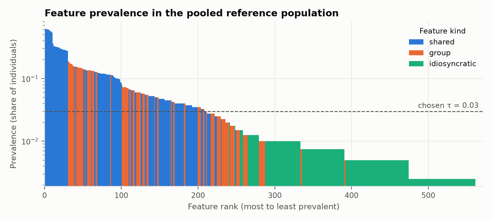
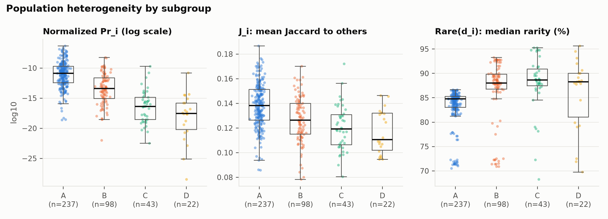
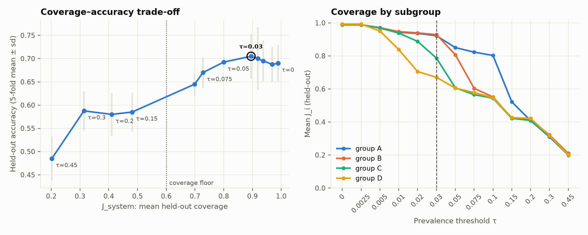
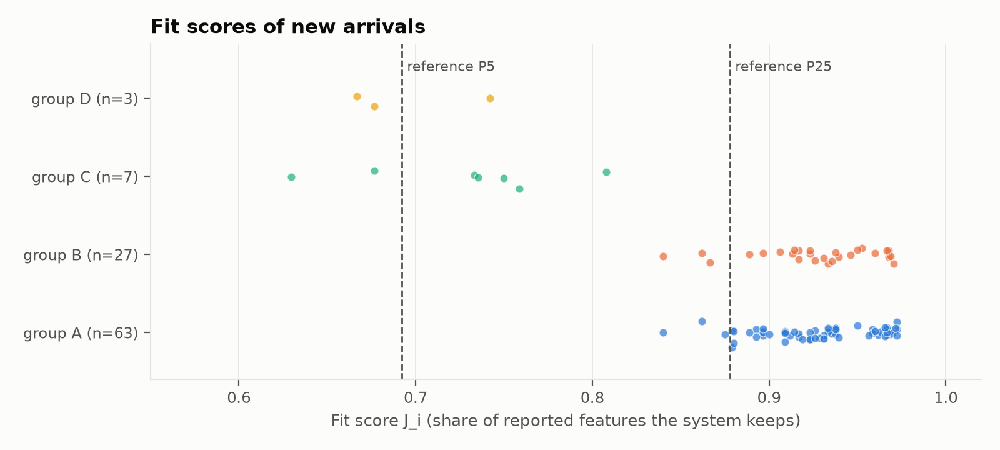

# Representation report

## 1. Reference population (Phase I)

- **individuals**: 400
- **distinct features**: 561
- **features per individual (median)**: 29.0
- **features held by a single individual**: 87
- **features held by <1% of individuals**: 228
- **individuals with a unique feature vector**: 100%
- **median j_pop**: 0.132
- **median normalized Pr_i**: 7.12e-13
- **median Rare(d_i) (%)**: 85.2

Heterogeneity measures by subgroup:

| group | n | features_median | log10_pr_i_median | log10_pr_i_norm_median | j_pop_mean | rarity_median | unique_share |
|---|---|---|---|---|---|---|---|
| A | 237 | 29 | -34.9 | -10.9 | 0.138 | 84.8 | 100% |
| B | 98 | 29 | -37.1 | -13.4 | 0.127 | 88.0 | 100% |
| C | 43 | 31 | -41.5 | -16.4 | 0.120 | 88.6 | 100% |
| D | 22 | 28 | -41.0 | -17.5 | 0.117 | 88.2 | 100% |

## 2. Feature selection & calibration (Phase II)

The prevalence threshold was swept with 5-fold cross-validation. The chosen threshold is **τ = 0.03**: it has the highest held-out accuracy among thresholds with J_system ≥ 0.6.

| tau | n_selected | j_system | j_worst_group | accuracy | accuracy_sd |
|---|---|---|---|---|---|
| 0 | 539 | 0.989 | 0.988 | 0.690 | 0.039 |
| 0.0025 | 539 | 0.989 | 0.988 | 0.690 | 0.039 |
| 0.005 | 435 | 0.969 | 0.950 | 0.688 | 0.037 |
| 0.01 | 294 | 0.937 | 0.838 | 0.695 | 0.044 |
| 0.02 | 237 | 0.919 | 0.705 | 0.700 | 0.068 |
| 0.03 | 211 | 0.895 | 0.670 | 0.705 | 0.048 |
| 0.05 | 148 | 0.800 | 0.605 | 0.693 | 0.013 |
| 0.075 | 106 | 0.728 | 0.565 | 0.670 | 0.033 |
| 0.1 | 95 | 0.699 | 0.544 | 0.645 | 0.024 |
| 0.15 | 45 | 0.481 | 0.422 | 0.585 | 0.042 |
| 0.2 | 30 | 0.411 | 0.408 | 0.580 | 0.047 |
| 0.3 | 21 | 0.314 | 0.310 | 0.588 | 0.043 |
| 0.45 | 10 | 0.202 | 0.199 | 0.485 | 0.047 |

## 3. What the deployed system represents

- Features used: **211** of 570
  - shared: 140 of 150
  - group: 71 of 120
  - idiosyncratic: 0 of 300
- J_system (held-out): **0.895**; 10% of individuals are at or below 0.769
- Held-out accuracy: **0.705** ± 0.048

Coverage and accuracy by subgroup at the chosen τ (out-of-fold):

| group | share | j_sys | accuracy |
|---|---|---|---|
| A | 0.593 | 0.922 | 0.747 |
| B | 0.245 | 0.929 | 0.633 |
| C | 0.107 | 0.787 | 0.628 |
| D | 0.055 | 0.670 | 0.727 |

Coverage gap: group D keeps 67% of its reported features on average, compared with 93% for group B.

## 4. New arrivals (Phase III)

- 100 new individuals scored; accuracy on them: **0.730**

Fit bands by subgroup:

| group | poorly represented | partially represented | well represented |
|---|---|---|---|
| A | 0 | 3 | 60 |
| B | 0 | 3 | 24 |
| C | 2 | 5 | 0 |
| D | 2 | 1 | 0 |

The 5 lowest-fit arrivals:

#### Fit report: new_020

- **Fit score (J_i)**: 0.68, at the 3rd percentile of the reference population. **poorly represented**
- Features the system keeps: 23 of 34 reported
- Collision probability: log10 Pr_i = -50.0; normalized Pr_i = 1.21e-23 (0th percentile)
- Rarity Rare(d_i): 89.8% (88th percentile)
- Features the system omits: uncommon_38, groupD_03, groupD_10, groupD_18, groupD_20, groupD_22, groupD_25, groupD_26, groupD_27, idio_060, idio_131

#### Fit report: new_040

- **Fit score (J_i)**: 0.73, at the 7th percentile of the reference population. **partially represented**
- Features the system keeps: 22 of 30 reported
- Collision probability: log10 Pr_i = -43.8; normalized Pr_i = 3.19e-20 (3rd percentile)
- Rarity Rare(d_i): 91.9% (92nd percentile)
- Features the system omits: uncommon_50, groupC_15, groupC_16, groupC_21, groupC_22, idio_036, idio_172, idio_264

#### Fit report: new_044

- **Fit score (J_i)**: 0.63, at the 1st percentile of the reference population. **poorly represented**
- Features the system keeps: 17 of 27 reported
- Collision probability: log10 Pr_i = -42.1; normalized Pr_i = 3.23e-20 (3rd percentile)
- Rarity Rare(d_i): 95.0% (99th percentile)
- Features the system omits: uncommon_50, groupC_02, groupC_05, groupC_08, groupC_18, groupC_20, idio_025, idio_153, idio_175, idio_295

#### Fit report: new_059

- **Fit score (J_i)**: 0.68, at the 3rd percentile of the reference population. **poorly represented**
- Features the system keeps: 23 of 34 reported
- Collision probability: log10 Pr_i = -48.0; normalized Pr_i = 1.18e-21 (2nd percentile)
- Rarity Rare(d_i): 95.6% (100th percentile)
- Features the system omits: uncommon_49, groupC_05, groupC_07, groupC_10, groupC_13, groupC_15, groupC_16, groupC_23, groupC_28, idio_012, idio_039

#### Fit report: new_074

- **Fit score (J_i)**: 0.67, at the 3rd percentile of the reference population. **poorly represented**
- Features the system keeps: 18 of 27 reported
- Collision probability: log10 Pr_i = -38.2; normalized Pr_i = 2.47e-16 (18th percentile)
- Rarity Rare(d_i): 86.3% (64th percentile)
- Features the system omits: groupD_11, groupD_13, groupD_14, groupD_15, groupD_16, groupD_18, groupD_19, groupD_27, idio_139

